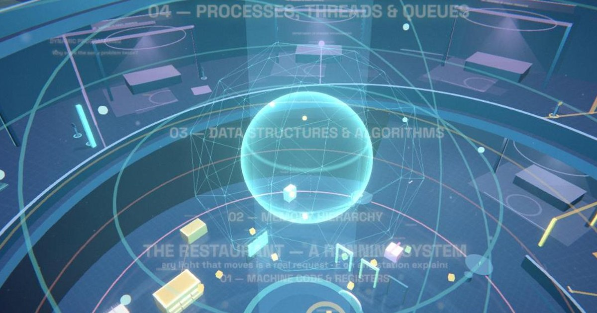

# The Museum of Software Engineering



A walkable 3D museum of software engineering that runs in the browser. You climb a spiral ramp through ten departments: principles and design, algorithms, dynamic programming, data and storage, protocols, messaging, concurrency, infrastructure and distributed systems. Every exhibit acts its idea out, and all of them describe one fictional restaurant system.

**Live site:** https://mbouallegue.github.io/software-engineering-museum/

## What's inside

- **29 halls.** Each one has an installation you can operate, a reference guide, code samples and interview notes.
- **A running restaurant** on the atrium floor. Every moving light is a request from the simulator, and robot staff react to the same events:
  - Kitchen robots knead dough when a job starts and shake their heads at a duplicate delivery.
  - The waiter carries the finished order to a table.
  - If you crash the workers, the kitchen robots collapse.
- **Follow an order** (press `G`, or choose it from Stories). The camera rides along with one live request, and a route bar shows every component it visits, what happened there and how long it took.
- **Six guided stories** (press `L`). Each is a deterministic simulation with a real timeline: play, pause, step back, change one engineering decision, and compare the two runs.
  - A: follow one order through the system
  - B: why database indexes matter
  - C: a queue under pressure
  - D: a race condition
  - E: a distributed failure
  - F: Kafka replay
- **The system view** (press `V`). The same restaurant drawn as a blueprint, as C4 levels, as a live runtime and as a failure map, with a control room where you can break it and defend it.

## Controls

| Key | Action |
| --- | --- |
| `W A S D` / drag | Walk / look around |
| `E` | Explain the exhibit in front of you. Press again for its guide |
| `1`–`9` | Operate the exhibit |
| `G` | Follow an order across the restaurant floor |
| `L` | Stories |
| `V` | The system view |
| `M` | Map and search |
| `P` | Pause the whole museum |
| `?` | Help |

## Rendering

Everything is three.js r128 plus its official add-ons from the same release.

- **HDR post-processing.** The scene renders into a half-float target, then goes through `UnrealBloomPass`, a custom grade pass and FXAA. The grade pass handles highlight roll-off, sRGB encoding, contrast, a cool-shadow/warm-highlight split tone, vignette and light grain.
- **Image-based lighting.** A procedural environment (a gradient sky, a ring of cold light overhead, warm and cool horizon panels) is prefiltered with `PMREMGenerator`, so frames and plinths read as metal.
- **Shadows from a key light that follows the visitor.** The frustum is snapped to a grid so edges don't shimmer, and the near/far planes keep the floors above you out of the pass. The map refreshes every 2nd or 3rd frame.
- **A polished atrium floor.** A `Reflector` with a custom Fresnel-weighted, slightly blurred shader.
- **Shader details.** Light cones over every installation that brighten as you approach, GPU-animated dust, and an energy core that pulses with live traffic and turns red when the system is unhealthy.
- **Models.** `GLTFLoader` and `SkeletonUtils` clone one animated robot rig into five independent robots, each with its own `AnimationMixer` and cross-faded clips.
- **Readable at a distance.** Floating labels fade with distance.

**Graphics** in the settings menu (⚙) has three modes:

- **Auto** (the default) picks what the device can keep smooth and steps down on its own if frames drop.
- **High** always uses bloom, 2k soft shadows and the reflective floor.
- **Fast** renders directly with no post-processing.

You can also set the mode in the URL: `?graphics=high`, `?graphics=fast` or `?graphics=auto`.

## Run it locally

Serve the folder rather than opening `index.html` from disk, because browsers block model loading on `file://` pages. From the project folder:

```sh
python -m http.server 8000
# then open http://localhost:8000
```

Before committing, run the checks: `node tools/check.js`. They also run on every push.

## Project layout

```
index.html        markup and the script list
css/              museum, stories, panels
js/content/       exhibit text, guides, the concept graph
js/system/        the restaurant topology, the simulator, the System view
js/world/         the building, installations, restaurant floor, models
js/app/           navigation, explain card, settings, input, main loop
js/gfx/           the rendering layer
js/stories/       the six scenarios and their player
assets/models/    CC0 robot, furniture and food
```

[docs/ARCHITECTURE.md](docs/ARCHITECTURE.md) explains how the pieces fit together, and how to add a story or a model.

## Publish with GitHub Pages

1. Push this folder to a public GitHub repository.
2. In the repository, go to **Settings → Pages**.
3. Under **Build and deployment**, choose **Deploy from a branch**, then select `main` and `/ (root)`.
4. After about a minute, the site is live at `https://<your-username>.github.io/<repository-name>/`.

## Credits

- [Three.js](https://threejs.org/) r128 from cdnjs, and its r128 add-ons from jsDelivr.
- RobotExpressive by Tomás Laulhé ([Quaternius](https://quaternius.com/)), CC0.
- Furniture Kit and Food Kit by [Kenney](https://kenney.nl/), CC0.
- Inter, Space Grotesk and JetBrains Mono from Google Fonts.

See [assets/CREDITS.md](assets/CREDITS.md) for the asset details.

## License

Code: [MIT](LICENSE). Third-party models: CC0, as listed in `assets/CREDITS.md`.
